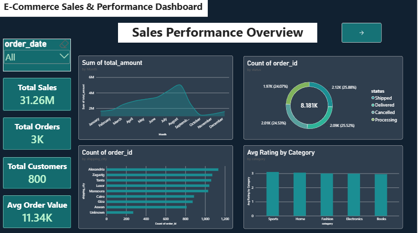
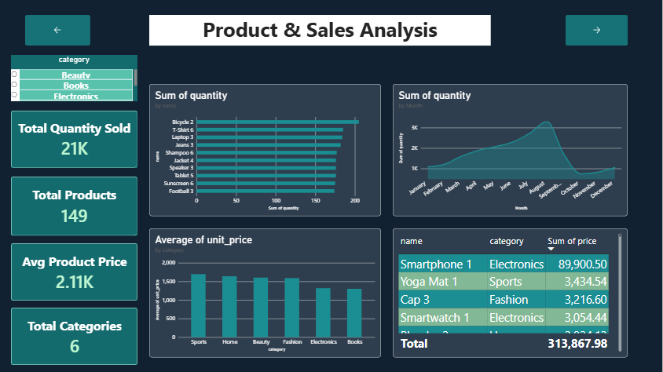
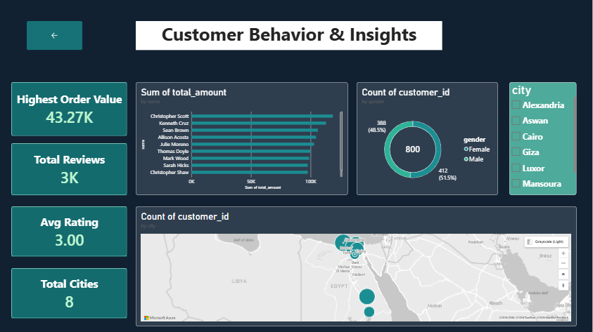
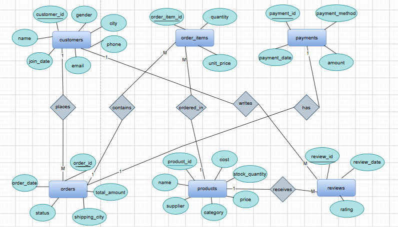

# E-Commerce Data Analysis Project

An end-to-end data analytics project that transforms raw synthetic e-commerce data into meaningful business insights using Python, SQL Server, Excel, and Power BI.

The project covers the complete data analytics workflow, from data generation and cleaning to database design, business analysis, reporting, and interactive visualization.

## Dashboard Preview

### 1. Sales Performance Overview

### 2. Product & Sales Analysis

### 3. Customer Behavior & Insights

## Database Design (ERD)
The Entity Relationship Diagram illustrates the structure of the six database tables and their relationships.

## Project Overview

### The Problem
E-commerce businesses generate large amounts of data related to customers, products, orders, payments, and reviews. Without proper organization and analysis, identifying sales trends, understanding customer behavior, and evaluating business performance can be challenging.

This project organizes and analyzes e-commerce data to answer key business questions, identify top-performing products and customer segments, and evaluate order and sales performance.

### Project Objectives
- Generate a realistic synthetic e-commerce dataset.
- Identify and handle data-quality issues using Python.
- Design a relational database in SQL Server.
- Analyze business performance using SQL queries.
- Summarize findings using Excel reports and charts.
- Build an interactive Power BI dashboard for business insights.

## Project Workflow

1. **Planning**: Defined the project scope and designed six related tables representing the main components of an online store.
2. **Data Generation**: Generated synthetic e-commerce data using Python and Faker in Google Colab. Data-quality issues were intentionally introduced to simulate real-world cleaning scenarios.
3. **Data Cleaning**: Used pandas to handle duplicate records, missing values, inconsistent city names, negative stock values, and invalid ratings.
4. **Python Analysis**: Performed exploratory data analysis: monthly sales trends, top 10 products, sales by product category, and customer segmentation into High, Medium, and Low groups.
5. **Database Design**: Created a relational database named EcommerceDB in SQL Server, consisting of six tables connected through primary and foreign keys.
6. **SQL Analysis**: Developed 10 business queries to explore the dataset, join related tables, and answer business questions.
7. **Entity Relationship Diagram**: Designed the ERD using draw.io and Chen notation.
8. **Excel Reporting**: Used Power Query, five PivotTables, and charts to summarize the data and present key findings.
9. **Power BI Dashboard**: Built an interactive dashboard with three pages: Overview, Product & Sales Analysis, and Customer Behavior & Insights.

## Database Overview

**Database Name:** EcommerceDB

| Table | Rows | Description |
| --- | --- | --- |
| customers | 800 | Customer names, emails, phone numbers, cities, gender, and join dates |
| products | 149 | Product categories, prices, costs, and stock levels |
| orders | 2,757 | Order dates, statuses, shipping cities, and order values |
| order_items | 8,181 | Products and quantities associated with each order |
| payments | 2,067 | Payment methods, amounts, and payment dates |
| reviews | 2,777 | Customer ratings from 1 to 5 and review dates |

## Key Performance Indicators
- **Total Sales:** 31.26M
- **Average Order Value:** 11.34K
- **Total Customers:** 800
- **Total Products:** 149
- **Product Categories:** 6
- **Cities:** 8
- **Average Rating:** 3.00 / 5

## Key Business Insights
- Sales are concentrated in a limited number of top-performing products and categories.
- A small group of high-value customers contributes a large share of total sales.
- A meaningful share of orders is cancelled, which represents lost revenue.

## Project Files

| File | Description |
| --- | --- |
| [EcommerceDB_Python.ipynb](EcommerceDB_Python.ipynb) | Generates the synthetic dataset, cleans the data, and performs Python analysis |
| [SQL.Project_Ecommerce.sql](SQL.Project_Ecommerce.sql) | Creates and queries the SQL Server database |
| [Excel.Project_Ecommerce.xlsx](Excel.Project_Ecommerce.xlsx) | Excel analysis, PivotTables, and charts |
| [PowerBI.Project_E-Commerce.pbix](PowerBI.Project_E-Commerce.pbix) | Interactive dashboard for exploring business performance |
| [Project_Documentation.docx](Project_Documentation.docx) | Detailed documentation of the project |
| [Presentation.pptx](Presentation.pptx) | Presentation explaining the project workflow and results |
| [images/](images) | Dashboard screenshots and database diagram |

## How to Run

**Python**
Open `EcommerceDB_Python.ipynb` in Google Colab or Jupyter Notebook. The project uses `faker`, `pandas`, `numpy`, `matplotlib`, and `seaborn`.

**SQL Server**
Import the cleaned CSV files as the `*_clean` tables, then open `SQL.Project_Ecommerce.sql` in SQL Server Management Studio (SSMS) and run it.

**Excel**
Open `Excel.Project_Ecommerce.xlsx` in Microsoft Excel to review the report and charts.

**Power BI**
Open `PowerBI.Project_E-Commerce.pbix` in Power BI Desktop. Configure the data source if prompted.

## Tools & Technologies
- **Programming and Data Analysis:** Python, pandas, NumPy
- **Data Generation:** Faker
- **Data Visualization:** Matplotlib, Seaborn, Power BI
- **Database:** Microsoft SQL Server
- **Reporting:** Microsoft Excel, Power Query, PivotTables
- **Database Modeling:** draw.io

## Author

**Jana Ahmed Soliman Elmeligy**

LinkedIn: [Jana Elmeligy](https://www.linkedin.com/in/jana-elmeligy-4b47a932a)

Personal project demonstrating an end-to-end data analytics workflow, including data generation, cleaning, exploratory analysis, relational database design, SQL querying, reporting, and dashboard development.
